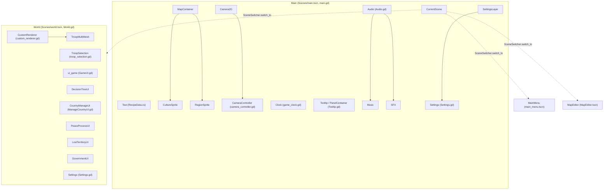
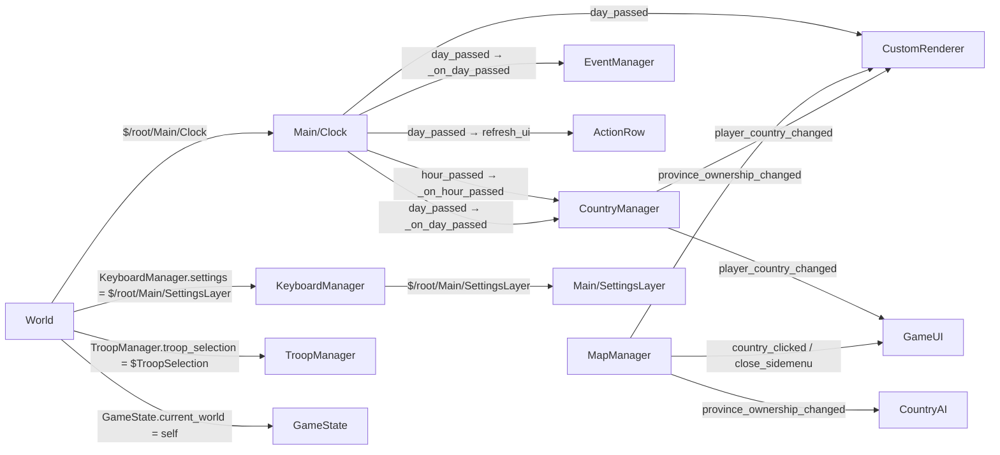
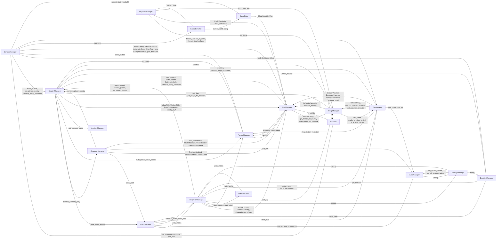

# Node & Function Dependencies

Generated from a scan of every `.gd` file (excluding `addons/`) for `<Autoload>.<member>` calls, `$`/`get_node` paths, and `.connect()` calls. Arrow labels are the functions/members that the source calls on the target.

## 1. Scene tree

## 2. Signals & node-path lookups

## 3. Autoload ↔ autoload

## 4. Scene scripts & data classes → autoloads

```mermaid
flowchart LR
    %% Bootstrap / loading
    main_gd["main.gd"] -- "switch_to" --> SceneSwitcher
    StartEntry -- "current_start" --> GameState
    StartEntry -- "switch_to" --> SceneSwitcher
    MainMenu -- "settings" --> KeyboardManager
    Audio -- "setup_audio" --> MusicManager

    World -- "initialize_countries, SaveCountries, set_player_country" --> CountryManager
    World -- "load_events, save_events" --> EventManager
    World -- "Initialize, SaveFactions" --> FactionManager
    World -- "HandleClick, HandleHover, _BuildGlobalRegistry, Save*" --> MapManager
    World -- "load_wars, save_wars, check_for_new_battles, reset_state" --> WarManager
    World -- "clear_all_troops" --> TroopManager
    World -- "apply_settings" --> SettingsManager

    MapData -- "LoadProvinces, LoadBiomes, LoadResources, BuildLookupTexture" --> MapManager
    MapData -- "initialize_countries, generate_missing_leaders" --> CountryManager
    MapData -- "load_decisions_from_path" --> DecisionManager
    MapData -- "LoadBuildings, initialize" --> EconomyManager
    MapData -- "load_super_events" --> EventManager
    MapData -- "Initialize" --> FactionManager
    MapData -- "Initialize" --> IdeologyManager
    MapData -- "load_plans_from_path" --> PlansManager
    MapData -- "set_custom_flag_path" --> TroopManager
    MapData -- "load_wars, load_original_territories" --> WarManager

    %% Simulation
    CountryData -- "process_country_day" --> DecisionManager
    CountryData -- "get_country_gdp, get_country_population" --> CountryManager
    CountryData -- "DeployReady, deploy_specific_divisions" --> TroopManager
    CountryData -- "get_enemies_of" --> WarManager
    CountryData -- "get_ideology_name" --> IdeologyManager
    CountryData -- "owns" --> CountryAI
    CountryAI -- "declare_war, call_to_arms, get_enemies_of" --> WarManager
    CountryAI -- "DeployReady, command_move_assigned" --> TroopManager
    CountryAI -- "_ProvinceBuildIndustry, IncreaseWorldTension, GetProvincesBorderingEnemies" --> MapManager
    CountryAI -- "construction_queue" --> EconomyManager
    CountryAI -- "factions, in_faction" --> FactionManager
    SoiStar -- "province_objects" --> MapManager
    TroopData -- "countries" --> CountryManager

    %% World-scene nodes
    CustomRenderer -- "troops, troop_selection, get_flag" --> TroopManager
    CustomRenderer -- "active_battles" --> WarManager
    CustomRenderer -- "province_centers, all_cities" --> MapManager
    TroopSelection -- "command_move_assigned, RemoveTroop, _start_next_leg" --> TroopManager
    TroopSelection -- "GetProvinceAtPos, province_graph" --> MapManager
    TroopSelection -- "play_sfx" --> MusicManager

    %% UI
    GameUI -- "create_faction, invite_faction, kick_faction" --> FactionManager
    GameUI -- "declare_war, call_to_arms, is_at_war" --> WarManager
    GameUI -- "SetMapMode, AnnexCountry, ShowIndustryCountry" --> MapManager
    GameUI -- "make_puppet, release_puppet, set_player_country" --> CountryManager
    GameUI -- "play_music, skip_track, radios" --> MusicManager
    GameUI -- "has_available_decisions" --> DecisionManager
    GameUI -- "has_available_plans" --> PlansManager
    GameUI -- "building_designs, construction_queue" --> EconomyManager
    GameUI -- "save_settings" --> SettingsManager
    DecisionTreeUI -- "start_decision, save_country_decisions, get_country_categories" --> DecisionManager
    ManageCountryUI -- "ReleaseCountry, ReleasePuppet, TransferOwnership" --> MapManager
    ManageCountryUI -- "make_puppet, set_player_country" --> CountryManager
    ManageCountryUI -- "get_element" --> InterpreterManager
    ManageCountryUI -- "plans" --> PlansManager
    PeaceProcessUI -- "TransferOwnership, InstantiateCountryFromProvinces" --> MapManager
    PeaceProcessUI -- "make_puppet" --> CountryManager
    LostTerritoryUI -- "MakeHost, release_puppet, set_player_country" --> CountryManager
    GovernmentUI -- "significantFigures" --> MapManager
    Settings -- "switch_to" --> SceneSwitcher
    Settings -- "apply_settings, save_settings" --> SettingsManager
    Tooltip -- "GetResourceIcon, current_hovered_pid" --> MapManager
    Tooltip -- "construction_queue" --> EconomyManager
    building_designer -- "building_designs, building_functions" --> EconomyManager
    building_designer -- "uses" --> TagMatcher
    ExpressionBox -- "functions, get_param_name" --> InterpreterManager
    custom_event_popup -- "get_element, refresh_buttons" --> InterpreterManager
    MapEditorUI -- "TransferOwnership, SetProvinceColor(s), Occupy/DeoccupyProvince" --> MapManager
    MapEditorUI -- "RenameCountry, make_puppet" --> CountryManager
    CreationPopupUI -- "InstantiateCountryFromProvinces" --> MapManager
    CreationPopupUI -- "add_country, MakeHost" --> CountryManager
    CreationPopupUI -- "create_faction" --> FactionManager
    CameraController -- "MAP_HEIGHT" --> MapManager
    game_clock -- "game_ui, in_peace_process" --> GameState
```

Notes:
- `GameState` is read by almost every script (`current_world`, `game_ui`, `selectingCountry`, ...). Those edges are left out of section 4 to keep the graph readable.
- `Console.is_visible` is checked by `camera_controller`, `troop_selection`, `MapEditorUI`, `KeyboardManager` and `MapManager` to block input while the console is open.
- Autoload names that differ from file names: `SceneSwitcher` = `Managers/SceneManager.gd`, `Console` = the console addon.
